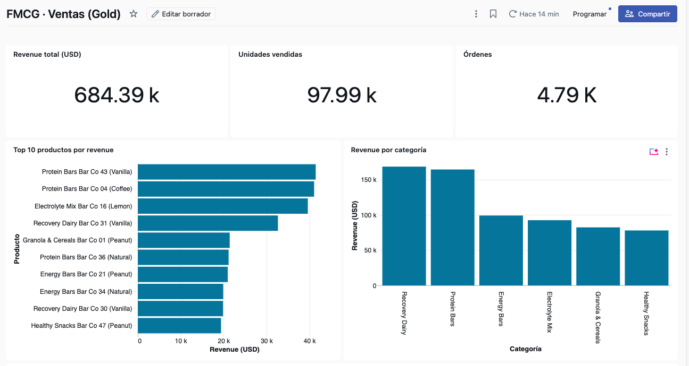
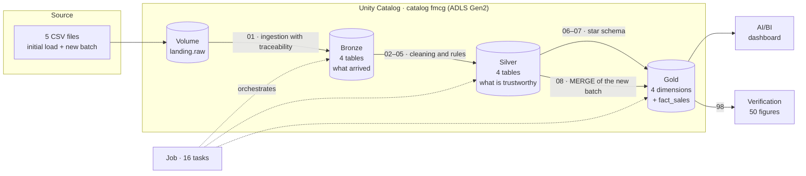
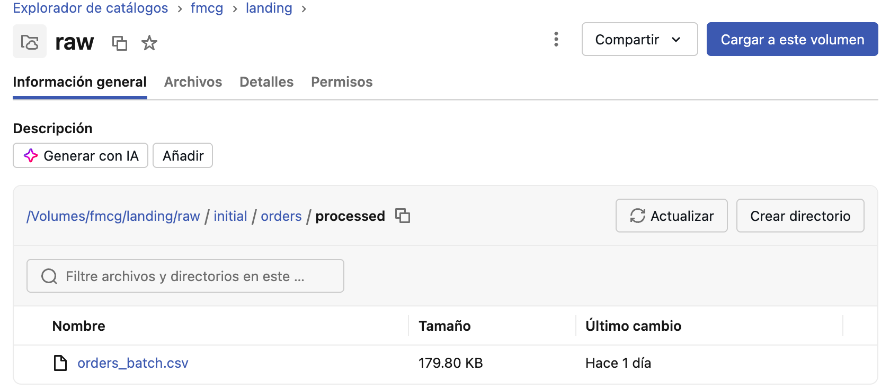
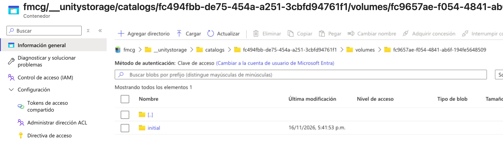
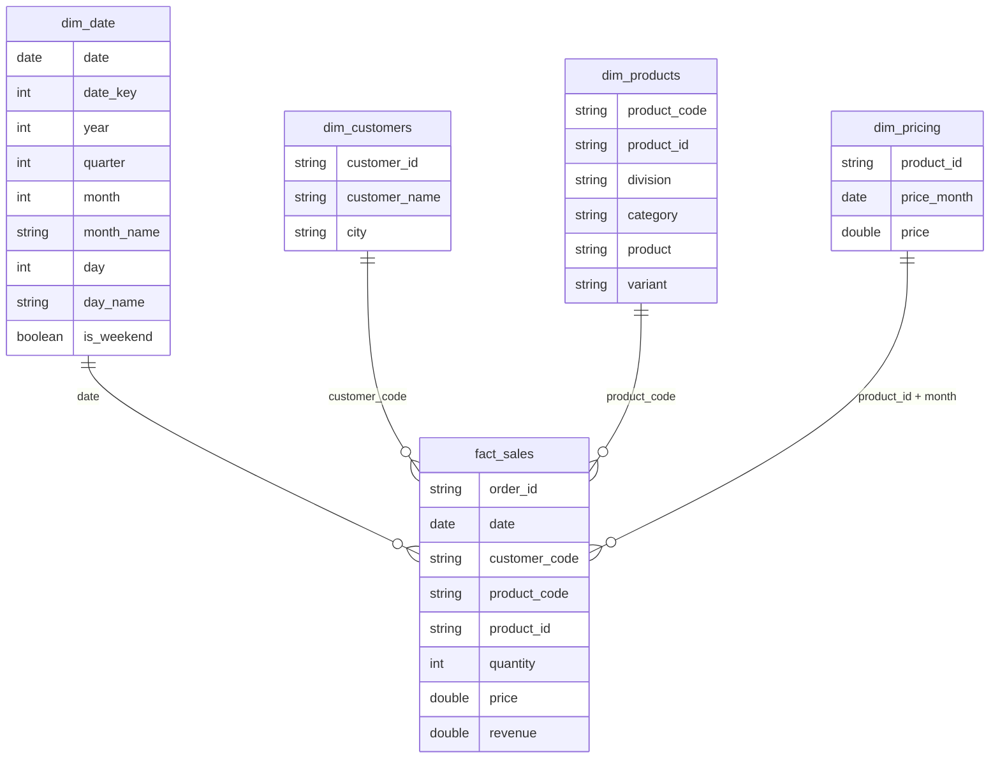
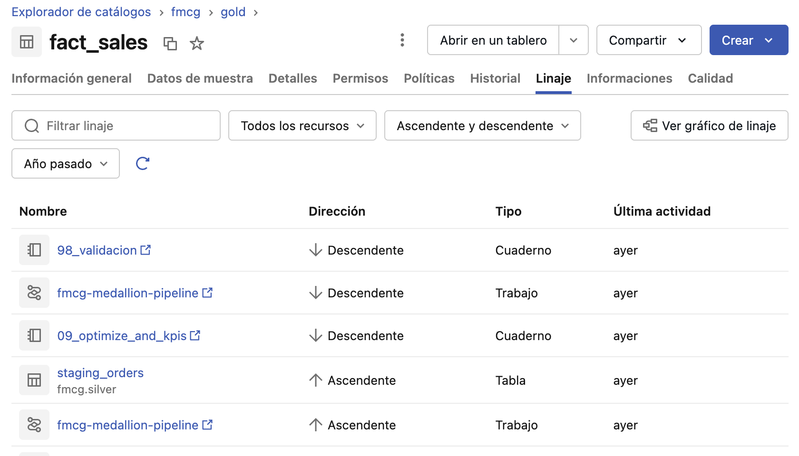
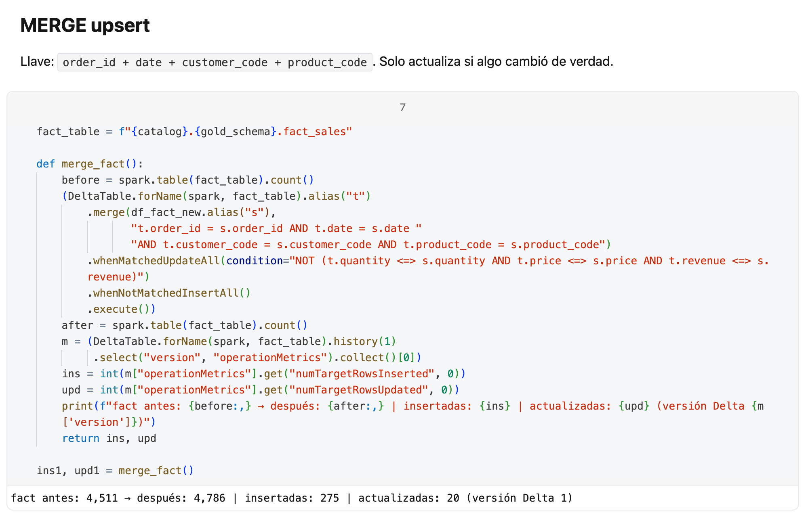
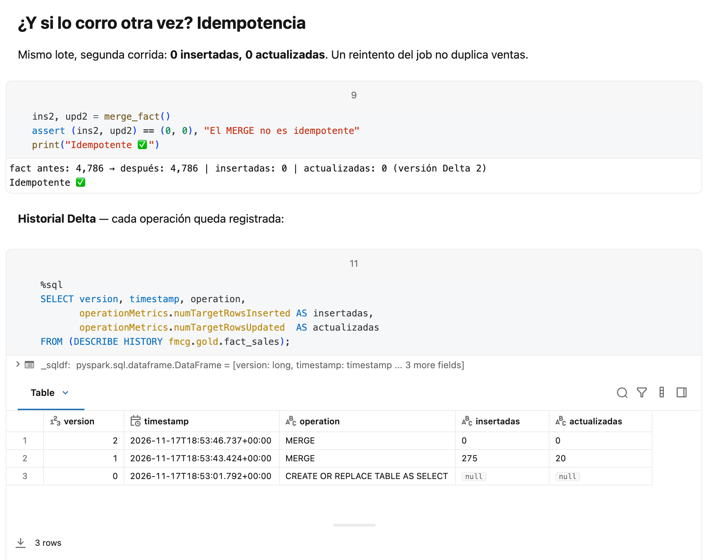
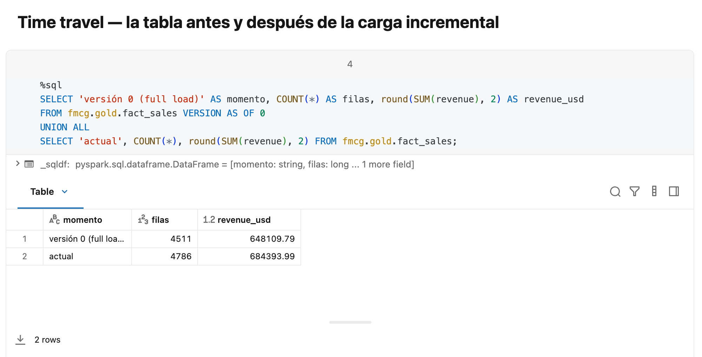
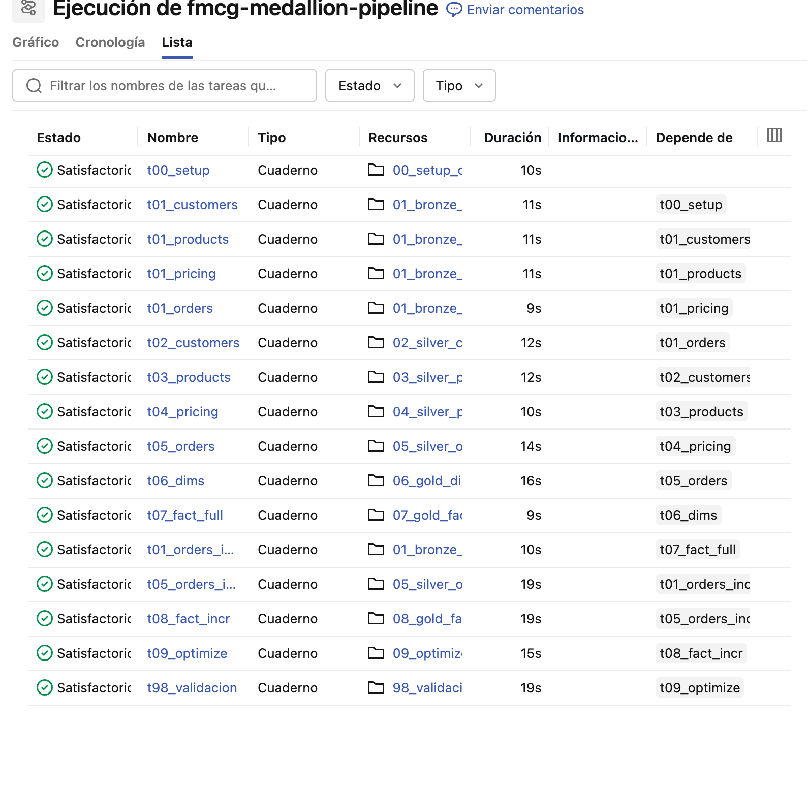

# FMCG Medallion Lakehouse on Azure Databricks

[Español](README.md) · **English**

> An Azure and Unity Catalog adaptation of the public project [databricks-medallion-lakehouse-fmcg](https://github.com/takadlag/databricks-medallion-lakehouse-fmcg) (AWS). What comes from the original and what this version adds: [Origin and authorship](#origin-and-authorship).

An end-to-end data pipeline for a fast-moving consumer goods (FMCG) distributor: it takes CSV files with real-world data entry errors, cleans them with explicit business rules, models them as a star schema and publishes them in a dashboard. Each new batch of orders is integrated with `MERGE` without duplicating sales, and every figure is checked against an independent calculation.

| | |
|---|---|
| **Result** | 13 Delta tables across three layers (plus two staging tables for the new batch) · 4,786 sales lines · US$ 684,393.99 in revenue · 50 of 50 figures verified |
| **Stack** | Azure Databricks · Unity Catalog · Delta Lake · PySpark · Spark SQL · Lakeflow Jobs · AI/BI Dashboards · ADLS Gen2 |
| **Run time** | About 4 minutes end to end with the job on a 4-core single-node cluster (3 min 51 s in the latest run) |
| **Data** | Synthetic and reproducible: 5 CSV files, 5,954 rows, generated with a fixed seed |



The notebooks, their comments and the screenshots are in Spanish.

## Contents

[The problem](#the-problem) · [Architecture](#architecture) · [Stack](#stack) · [Data model](#data-model) · [The pipeline, layer by layer](#the-pipeline-layer-by-layer) · [Incremental load](#incremental-load-and-idempotency) · [Verification](#verification) · [Orchestration](#orchestration) · [Design decisions](#design-decisions) · [How to run it](#how-to-run-it) · [Structure](#repository-structure) · [Limitations](#limitations-and-next-steps) · [Origin and authorship](#origin-and-authorship)

## The problem

A distributor receives four files from its systems every month: customers, products, price list and orders. They arrive the way data arrives at work:

| Source | Rows | What is wrong |
|---|---:|---|
| `customers` | 196 | 12 duplicates, names with stray spaces and lowercase, 11 misspellings of three cities, empty cities |
| `products` | 66 | 6 duplicates, lowercase categories, "Protien" instead of "Protein", 12 non-numeric identifiers |
| `gross_price` | 312 | The month in 4 different date formats, 24 product-month pairs with two prices |
| `orders` | 5,050 | 293 without quantity, 256 with an invalid customer, dates in 4 formats, 50 repeated rows |
| `orders` (new batch) | 330 | The same, plus 20 quantity corrections on orders that already exist |

These are the figures of the files as they arrive. Further down, [what happens to each bad record](#what-happens-to-each-bad-record) shows how many rows each rule affects: they do not always match, because one row can have two problems and it only counts under the first rule that reaches it.

The business asks how much was sold, in which category, and how it evolves month by month. Answering with trustworthy figures means deciding what to do with each bad record, and being able to prove the result is correct.

## Architecture



Each layer answers a different question:

- **Bronze, what arrived.** The CSV files as they are, plus the read timestamp and the source file of every row.
- **Silver, what is trustworthy.** No duplicates, correct types, normalized dates and business rules applied.
- **Gold, what answers the business.** A star schema ready to query.

Files land in a Unity Catalog Volume, which on Azure is a Data Lake Storage Gen2 container. Access is governed by the catalog: the notebooks carry no credentials and no storage paths.

| The Volume in Databricks | The same storage in Azure |
|---|---|
|  |  |

## Stack

| Layer | Technology | Purpose |
|---|---|---|
| Platform | Azure Databricks (Premium), DBR 16.4 LTS and serverless | Compute and workspace |
| Governance | Unity Catalog: catalog, schemas, Volume, lineage | Organization, permissions and traceability |
| Storage | Delta Lake on ADLS Gen2 | Transactional tables with version history |
| Transformation | PySpark and Spark SQL | Cleaning, business rules and modeling |
| Incremental load | Delta `MERGE` | Insert what is new, update what changed |
| Optimization | `OPTIMIZE` + `ZORDER` | Compact files and speed up filters |
| Orchestration | Lakeflow Jobs | 16 chained tasks with parameters |
| Consumption | AI/BI Dashboards (Lakeview) | Sales indicators |
| Verification | Plain Python, no Spark | Independent calculation of the expected figures |

## Data model



- **Grain of `fact_sales`:** one row per order line. The key is `order_id + date + customer_code + product_code`.
- **`revenue = quantity × price`**, using the price in force for that product in the month of the order.
- **`dim_customers` has 185 rows and Silver has 184:** the extra row is the member `999999 · Cliente Desconocido` (unknown customer), which receives the sales whose customer arrived invalid.
- **`dim_date` covers the whole year**, not only the days with sales, so future batches always find their date.

Unity Catalog records lineage without anyone documenting it: which tables and notebooks `fact_sales` comes from, and who consumes it.



## The pipeline, layer by layer

| Notebook | What it does | In → out |
|---|---|---|
| [`00_setup_catalog`](notebooks/00_setup_catalog.py) | Creates the catalog, the schemas and the Volume | — |
| [`01_bronze_load`](notebooks/01_bronze_load.py) | A single parameterized notebook for the 4 sources and both load modes. Adds source file and read timestamp, and moves the file to `processed/` | 196 · 66 · 312 · 5,050 |
| [`02_silver_customers`](notebooks/02_silver_customers.py) | Removes duplicates, normalizes names, fixes cities with a dictionary and an allow-list | 196 → 184 |
| [`03_silver_products`](notebooks/03_silver_products.py) | Normalizes category and name, derives the commercial division, generates a deterministic code per product (SHA-256 of the name) | 66 → 60 |
| [`04_silver_pricing`](notebooks/04_silver_pricing.py) | Converts the month to a date and keeps a single price per product and month | 312 → 288 |
| [`05_silver_orders`](notebooks/05_silver_orders.py) | Drops orders without quantity, flags invalid customers, normalizes dates, removes repeats and drops unknown products | 5,050 → 4,757 → 4,709 → 4,511 |
| [`06_gold_dims`](notebooks/06_gold_dims.py) | Builds the four dimensions | 365 · 185 · 60 · 288 |
| [`07_gold_fact_full_load`](notebooks/07_gold_fact_full_load.py) | Initial load of `fact_sales` with price and revenue | 4,511 rows · US$ 648,109.79 |
| [`08_gold_fact_incremental`](notebooks/08_gold_fact_incremental.py) | Merges the new batch with `MERGE` and demonstrates idempotency | 4,511 → 4,786 |
| [`09_optimize_and_kpis`](notebooks/09_optimize_and_kpis.py) | `OPTIMIZE ZORDER`, a query on an earlier version and the dashboard queries | — |
| [`98_validacion`](notebooks/98_validacion.py) | Extracts the actual figures from the tables for comparison | 50 figures |
| [`99_reset_demo`](notebooks/99_reset_demo.py) | Drops the tables and returns the CSV files to `landing/` | — |

Every code cell carries a comment saying what it does, and the key lines have a trailing explanation.

### What happens to each bad record

The policy is not the same for every case, and each difference has a reason:

| Case | Rows | What is done | Why |
|---|---:|---|---|
| Order without quantity | 293 | Dropped | Without a quantity there is no sale to measure |
| Repeated order | 48 | One is kept | Same order, date, customer, product and quantity. The file has 50; the other 2 had no quantity and were already dropped in the previous step |
| Order with an invalid customer | 230 | Kept, with customer `999999` | The sale happened; only the buyer is unknown. The initial file has 256; the rest were dropped by another rule |
| Order with an unknown product | 198 | Dropped | Without a product there is no price to compute revenue |
| Product with a non-numeric identifier | 12 | Kept, with `product_id` `999999` | The product exists and is identified by `product_code`. All 12 share that `product_id`, so they have no price and no orders |
| Customer without a valid city | 19 | 4 get the city confirmed by the business and 15 stay as "Sin ciudad" (no city) | No value is invented that nobody confirmed |

The counts for orders without quantity, repeated orders and unknown products refer to the initial load; the invalid-customer count refers to the final table. Dropped rows are counted at each step of the notebook, but they are not stored in a quarantine table.

## Incremental load and idempotency

A new file arrives with 330 orders. After Silver, 295 are valid: 275 are new orders and 20 correct the quantity of orders that already existed.

```python
(DeltaTable.forName(spark, fact_table).alias("t")
    .merge(df_fact_new.alias("s"),
           "t.order_id = s.order_id AND t.date = s.date "
           "AND t.customer_code = s.customer_code AND t.product_code = s.product_code")
    .whenMatchedUpdateAll(condition="NOT (t.quantity <=> s.quantity AND t.price <=> s.price AND t.revenue <=> s.revenue)")
    .whenNotMatchedInsertAll()
    .execute())
```

| | Inserted | Updated | `fact_sales` |
|---|---:|---:|---:|
| First run | 275 | 20 | 4,511 → 4,786 |
| Second run, same batch | 0 | 0 | 4,786 |

Jobs fail halfway and get retried. A load that duplicates on retry inflates sales; this one changes nothing the second time.

- **Quantity is left out of the key on purpose.** The 20 corrections in the batch change the quantity of an existing order: with quantity in the key they would be 20 new sales, not 20 updates.
- **The `<=>` condition** compares treating `NULL` as just another value, so only the rows that really changed are rewritten.
- **Scope of the guarantee.** Silver and Gold are idempotent because of `MERGE`; the change condition exists only in Gold, and the Silver one rewrites everything that matches even though the result is the same. In Bronze, the initial load overwrites the table and the new batch is appended to the history; to avoid reloading a file, it is moved from `landing/` to `processed/`. If the job fails between the write and the move, that file would end up twice in the Bronze history. It does not reach Silver, because the new batch is read from a staging table that is overwritten on every load, but file tracking is manual; Auto Loader would solve it.

| The `MERGE`, executed | Second run and table history |
|---|---|
|  |  |

Every write creates a version of the table, and any of them can be queried again: `VERSION AS OF 0` returns the 4,511 rows of the initial load even after the `MERGE` and the compaction.



## Verification

The question this project answers with evidence is "how do you know the numbers are right?".

1. [`qa/oraculo.py`](qa/oraculo.py) recomputes from the CSV files, in plain Python and without Spark, everything the pipeline must produce. The result is in [`qa/esperado.json`](qa/esperado.json).
2. The `98_validacion` notebook extracts the actual figures from the tables.
3. 50 figures are compared: rows per table, customers per city, products per category, revenue per category and per month, `MERGE` row counts, duplicate keys and sales without a dimension.

Result: 50 of 50. The actual output of the latest job run and its comparison are stored in [`qa/evidencia/`](qa/evidencia/). The same result was obtained in manual tests on serverless compute and with the `run_all` orchestrator; those are not recorded in the repository.

The independent calculation shares the business rules but not the engine. It detects implementation errors; it does not detect a badly chosen rule.

```bash
python3 qa/oraculo.py                      # recomputes the expected figures from the CSV files
python3 qa/comparar.py salida_98.json      # compares the output of notebook 98; exits with an error if anything differs
python3 qa/comparar.py --run <task_run_id> # the same, reading the run through the Databricks CLI
```

`salida_98.json` is the JSON printed by the last cell of the `98_validacion` notebook: copy it to a file. If you use the job, `<task_run_id>` is the run id of the `t98_validacion` task.

## Orchestration

A Lakeflow job chains 16 tasks: setup, four Bronze loads with different parameters on the same notebook, Silver, Gold, the incremental batch, optimization and validation. If a task fails, the following ones do not run, and the run is repaired from the task that failed.



The job definition is in [`jobs/fmcg-medallion-pipeline.json`](jobs/fmcg-medallion-pipeline.json) and the dashboard definition in [`dashboard/fmcg-ventas-gold.lvdash.json`](dashboard/fmcg-ventas-gold.lvdash.json).

## Design decisions

| Decision | Discarded alternative | Why |
|---|---|---|
| Unity Catalog Volume for file landing | Mounting a bucket or container with credentials | Access is governed by the catalog and the notebooks carry no secrets |
| Flag invalid customers as `999999` and keep the sale | Drop the order | The sale happened; losing it distorts revenue. The "unknown" member keeps it visible |
| Drop orders whose product is not in the master | Keep them without a price | Without a product there is no price and no revenue to compute |
| A single price per product and month, the highest | Keep both | With two prices, the join with orders would duplicate sales |
| `MERGE` with a four-column key and a change condition | Append rows or overwrite everything | A retry does not duplicate, and only what changed is rewritten |
| Unpartitioned fact table with `OPTIMIZE ZORDER` | Partition by date | At this volume, partitioning creates one tiny file per date, more than 150 |
| Dimensions rebuilt in full on every run | `MERGE` on dimensions too | They are small and their history is not needed in this case |
| Calendar generated for the whole year | Only dates with sales | Future batches always find their date |
| Verification against an independent calculation | Trusting that the notebook ran without errors | Running does not prove the number is correct |

### What did not work the first time

- **Tasks "running" for hours without writing anything.** The first hypothesis was a capacity shortage in the region. The real cause: the cluster was created with 0 workers and without single-node mode, so it started with nothing to execute the work. It was found by reading the cluster configuration, not by retrying.
- **Risk of duplicated sales.** There were 24 product-month pairs with two prices. It was detected by inspecting the data before doing the join.
- **The idempotency proof could not be repeated.** The notebook dropped the intermediate table when it finished. It surfaced when running the full demonstration twice.

## How to run it

You need a Databricks workspace with Unity Catalog and permission to create a catalog named `fmcg`. Tested on Azure Databricks Premium (created with the Azure free trial), on DBR 16.4 LTS and on serverless.

1. **Import** the `notebooks/` folder into your workspace. On import, Databricks drops the `.py` extension from the name.
2. **Run** `00_setup_catalog`. If your metastore does not allow `CREATE CATALOG` without a location, create the `fmcg` catalog from Catalog Explorer and run it again.
3. **Upload the CSV files** from `data/landing/` to the Volume, keeping the folders:
   ```bash
   databricks fs cp -r data/landing dbfs:/Volumes/fmcg/landing/raw
   databricks fs ls dbfs:/Volumes/fmcg/landing/raw/initial/orders/landing   # must list orders_batch.csv
   ```
   It requires the [Databricks CLI](https://learn.microsoft.com/azure/databricks/dev-tools/cli/), authenticated (`databricks auth login`). You can also upload them from Catalog Explorer.
4. **Run** `run_all`, which executes the whole pipeline in order.
5. **Check:** run `98_validacion` and compare its output with `python3 qa/comparar.py` (see [Verification](#verification)).

<details>
<summary>Step-by-step run, notebook by notebook</summary>

The Volume paths must end up like this:

```
/Volumes/fmcg/landing/raw/initial/customers/landing/customers_batch.csv
/Volumes/fmcg/landing/raw/initial/products/landing/products_batch.csv
/Volumes/fmcg/landing/raw/initial/gross_price/landing/prices_batch.csv
/Volumes/fmcg/landing/raw/initial/orders/landing/orders_batch.csv
/Volumes/fmcg/landing/raw/incremental/orders/landing/orders_incremental_batch.csv
```

Run order:

1. `01_bronze_load` four times, with `load_mode = initial` and `data_source` = `customers`, `products`, `gross_price`, `orders`
2. `02_silver_customers`, `03_silver_products`, `04_silver_pricing`
3. `05_silver_orders` with `load_mode = initial`
4. `06_gold_dims`, `07_gold_fact_full_load`
5. `01_bronze_load` with `data_source = orders` and `load_mode = incremental`
6. `05_silver_orders` with `load_mode = incremental`
7. `08_gold_fact_incremental`, `09_optimize_and_kpis`

Parameters are chosen in the dropdowns at the top of each notebook (`data_source` and `load_mode`).

To start over, `99_reset_demo` drops the tables and returns the CSV files to `landing/`. Always run it before repeating the pipeline: with no files in `landing/`, Bronze finishes without loading anything, and the query on version 0 of `fact_sales` assumes that version is the initial load.

</details>

<details>
<summary>Compute, job, dashboard and notebook comments</summary>

- **Compute:** serverless or a single-node cluster. If you create the cluster by hand, choose "Single node": a cluster with 0 workers without that mode starts with no executors and the notebooks hang.
- **Job:** it is defined for an existing cluster. In `jobs/fmcg-medallion-pipeline.json`, replace `<CARPETA_DEL_PROYECTO>` (project folder) and `<ID_DE_TU_CLUSTER>` (your cluster id) and create it with `databricks jobs create --json @jobs/fmcg-medallion-pipeline.json`.
- **Dashboard:** import `dashboard/fmcg-ventas-gold.lvdash.json` from Workspace → Import and assign it a SQL warehouse.
- **Comments:** `python3 tools/comentar_notebooks.py --quitar` removes the guiding comments from the notebooks without touching the code; without the argument, it puts them back.
- **Data:** `python3 data/gen_data.py` regenerates the same CSV files (fixed seed).

</details>

## Repository structure

```
├── notebooks/     14 notebooks in Databricks source format (00–09, 98, 99, run_all, utilities)
├── data/          gen_data.py and the 5 generated CSV files (initial and incremental load)
├── qa/            oraculo.py (independent calculation), esperado.json (expected figures), comparar.py and evidencia/ from the latest run
├── jobs/          definition of the 16-task job
├── dashboard/     definition of the sales dashboard
├── tools/         comentar_notebooks.py
└── deck/          slides presenting the project (open index.html, in Spanish) and screenshots
```

## Limitations and next steps

- **The data is synthetic.** It is designed to exercise every cleaning rule; it has neither the volume nor the surprises of a real system. For example, no customer with a numeric identifier is missing from the master, and the pipeline would not validate it.
- **Tracking of already loaded files is manual** (moving from `landing/` to `processed/`), and Bronze infers the schema. In production: Auto Loader or `COPY INTO`, with a declared schema.
- **If a batch brings the same order with two different quantities, the `MERGE` fails** on multiple matches: there is no "last one wins" rule. Deduplication does not choose which row survives either.
- **The 12 products with an invalid identifier share `product_id = 999999`.** Today they have no price and no orders; if an order arrived with that identifier, the join on `product_id` would multiply it by 12.
- **Silver and the dimensions are rebuilt in full** and keep no change history (SCD type 2). Only orders and the fact table are incremental.
- **Quality rules live in the code**, not declared as expectations the pipeline evaluates and reports, and there is no CI/CD and no automated tests on each change.
- **Others:** natural keys without surrogate keys, amounts in `DOUBLE` instead of `DECIMAL`, `ZORDER` with no measurable effect below 5,000 rows, Change Data Feed enabled with no consumer, calendar fixed to 2026 and the catalog name written out in the SQL cells.

Next steps: ingestion with Auto Loader, quality expectations with Lakeflow Declarative Pipelines, deployment with Databricks Asset Bundles and GitHub Actions, and SCD type 2 on customers.

## Origin and authorship

This project starts from [databricks-medallion-lakehouse-fmcg](https://github.com/takadlag/databricks-medallion-lakehouse-fmcg), by Tanmay Kadlag, built on AWS. The business case, the per-layer notebook structure and the cleaning rules come from there.

| From the original project | Contribution of this version |
|---|---|
| FMCG case and medallion structure | Migration from AWS/S3 to Azure with Unity Catalog Volumes |
| Silver cleaning rules | Reproducible synthetic data generator (the original ships no data) |
| Incremental load with `MERGE` | Change condition and a repeatable idempotency proof |
| | Self-contained model: the step that wrote to tables the original does not include was removed |
| | Verification against an independent calculation (50 figures) |
| | 16-task job, dashboard, reset notebook and commented notebooks |

It was presented at the charity workshop "Construye tu portafolio de datos End-to-End" by Datanilo Community (November 2026), built with Claude as a copilot: the assistant wrote a good part of the code, while the design decisions and the verification were human. The slides are in [`deck/`](deck/).

**Manuel Argüelles** · AI Analytics Engineer · [LinkedIn](https://www.linkedin.com/in/manuel-arguelles-ai/) · [analizodatos.com](https://analizodatos.com)

[MIT](LICENSE) license.
