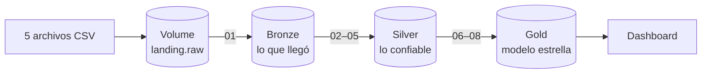
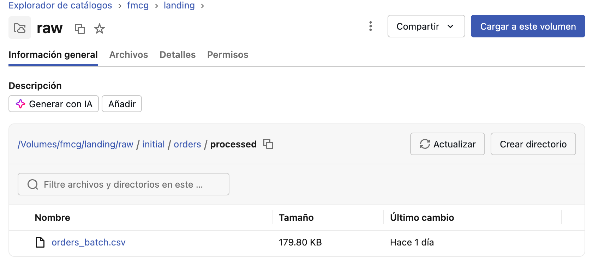
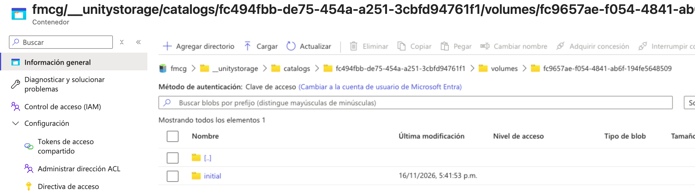
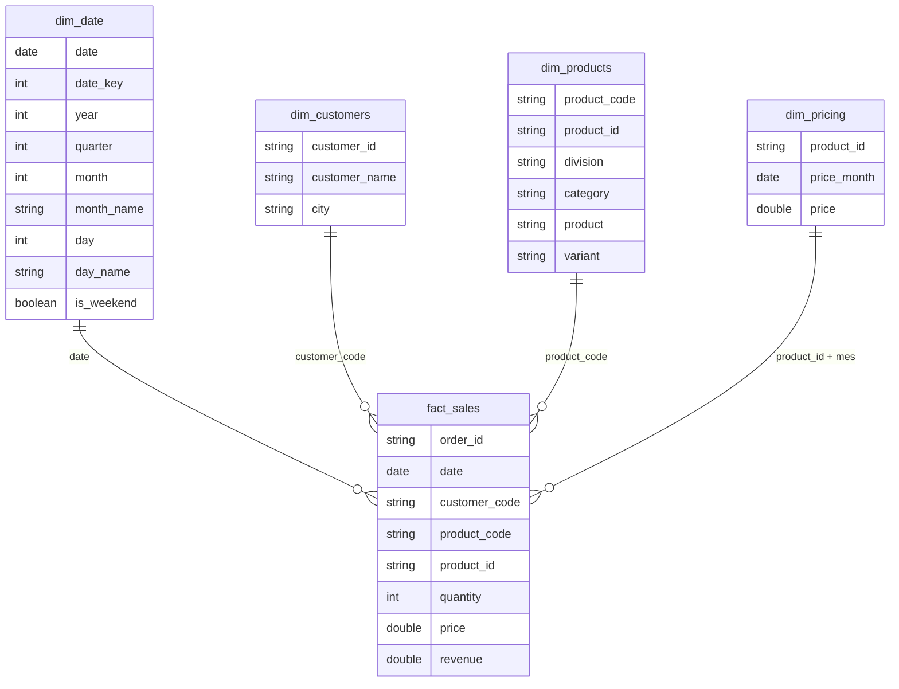
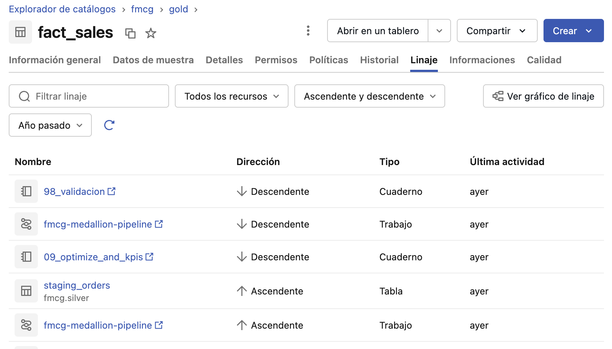
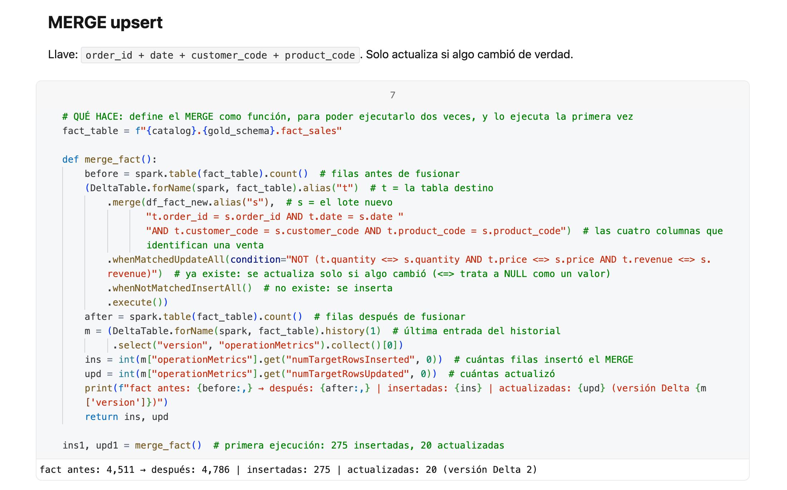
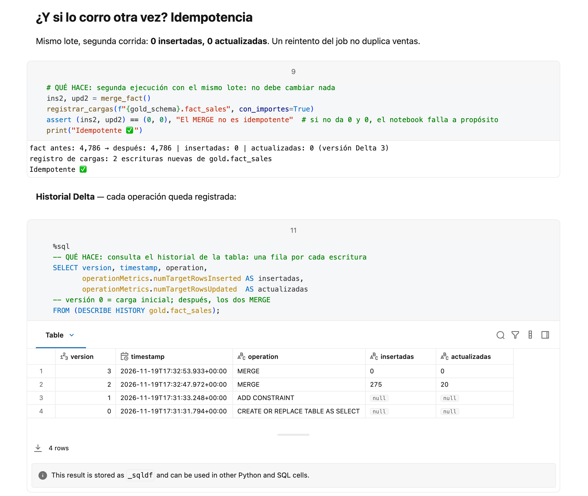
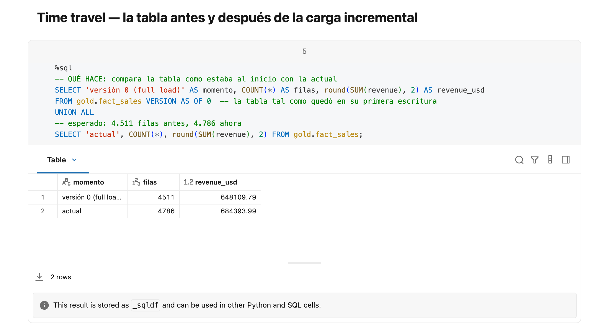
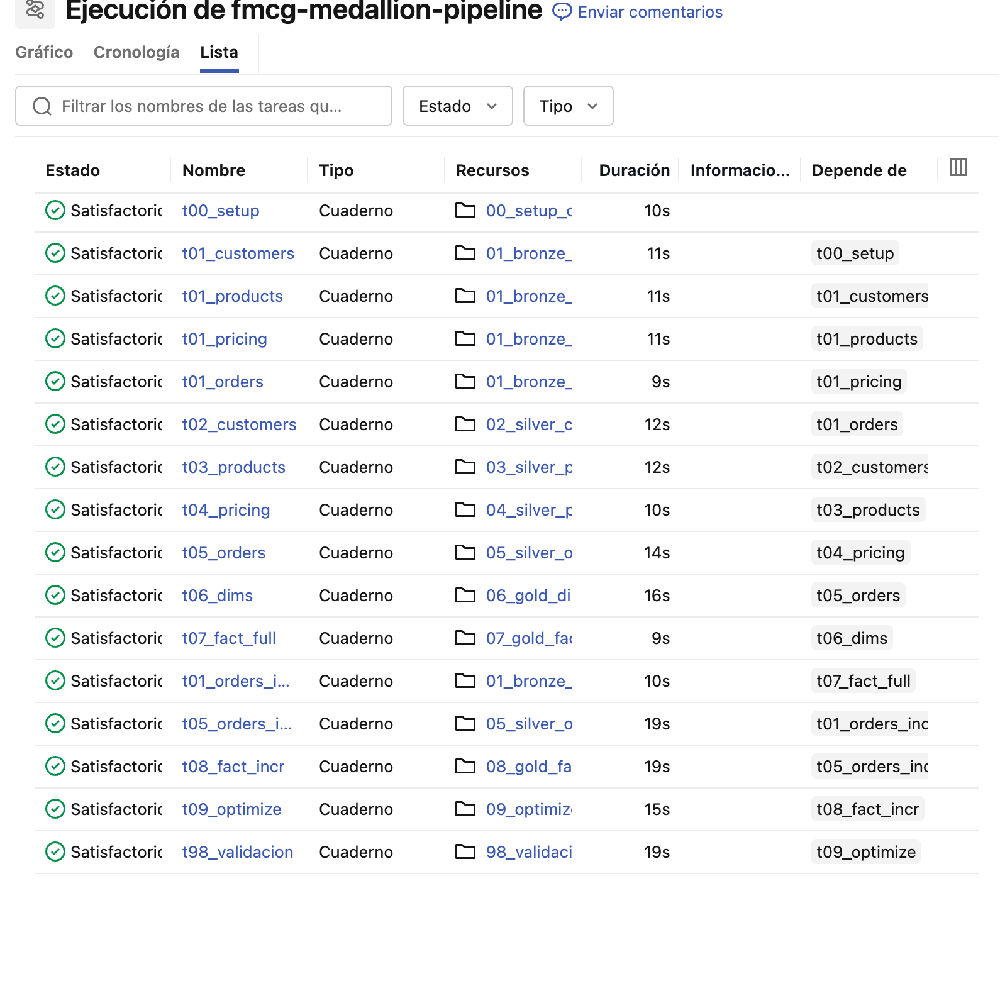

# FMCG Medallion Lakehouse en Azure Databricks

[](https://github.com/manuel-arguelles-ai/fmcg-medallion-lakehouse-azure/actions/workflows/ci.yml)

🇪🇸 **Español** · 🇺🇸 [English](README.en.md)

> Adaptación a Azure y Unity Catalog del proyecto público [databricks-medallion-lakehouse-fmcg](https://github.com/takadlag/databricks-medallion-lakehouse-fmcg) (AWS). Qué viene del original y qué aporta esta versión: [Origen y autoría](#origen-y-autoría).

Un pipeline de datos de punta a punta para una distribuidora de alimentos de consumo masivo (FMCG): recibe archivos CSV con errores reales de captura, los limpia con reglas de negocio explícitas, los modela en estrella y los publica en un dashboard. Cada lote nuevo de órdenes se integra con `MERGE` sin duplicar ventas, y todas las cifras se comprueban contra un cálculo independiente.

| | |
|---|---|
| **Resultado** | 13 tablas Delta en tres capas (más dos de paso para el lote nuevo) · 4.786 líneas de venta · US$ 684.393,99 de revenue · 50 de 50 cifras verificadas |
| **Stack** | Azure Databricks · Unity Catalog · Delta Lake · PySpark · Spark SQL · Lakeflow Jobs · AI/BI Dashboards · ADLS Gen2 |
| **Tiempo de ejecución** | Unos 4 minutos de principio a fin con el job en un cluster de un solo nodo de 4 núcleos ([3 min 51 s en la última ejecución](qa/evidencia/ejecucion_job.json)) |
| **Datos** | Sintéticos y reproducibles: 5 archivos CSV, 5.954 filas, generados con semilla fija |


**Lo que demuestra este proyecto**

- **Carga incremental que no duplica:** un `MERGE` con llave de negocio que, ejecutado dos veces con el mismo lote, inserta 0 y actualiza 0.
- **Cifras verificadas:** un cálculo independiente en Python puro reproduce las 50 cifras de control, y un flujo automático comprueba en cada cambio que ese cálculo sigue dando lo mismo y que coincide con la salida guardada de la última ejecución.
- **Reglas explícitas para los datos malos:** cada caso se corrige, se marca o se descarta, y está escrito por qué.

**Para verlo sin ejecutar nada:** la [comparación de las 50 cifras](qa/evidencia/comparacion.txt), el [registro de la última ejecución](qa/evidencia/ejecucion_job.json) con la duración de cada tarea, la tabla de [qué pasa con cada dato malo](#qué-pasa-con-cada-dato-malo) y la [última verificación automática](https://github.com/manuel-arguelles-ai/fmcg-medallion-lakehouse-azure/actions/workflows/ci.yml).

## Contenido

[El problema](#el-problema) · [Arquitectura](#arquitectura) · [Stack](#stack) · [Modelo de datos](#modelo-de-datos) · [El pipeline, capa por capa](#el-pipeline-capa-por-capa) · [Carga incremental](#carga-incremental-e-idempotencia) · [Verificación](#verificación) · [Orquestación](#orquestación) · [Decisiones de diseño](#decisiones-de-diseño) · [Cómo ejecutarlo](#cómo-ejecutarlo) · [Estructura](#estructura-del-repositorio) · [Limitaciones](#limitaciones-y-siguientes-pasos) · [Origen y autoría](#origen-y-autoría)

## El problema

Una distribuidora recibe cada mes cuatro archivos de sus sistemas: clientes, productos, lista de precios y órdenes. Los archivos traen estos problemas:

| Fuente | Filas | Qué trae mal |
|---|---:|---|
| `customers` | 196 | 12 duplicados, nombres con espacios y minúsculas, 11 formas erróneas de escribir tres ciudades, ciudades vacías |
| `products` | 66 | 6 duplicados, categorías en minúscula, «Protien» por «Protein», 12 identificadores no numéricos |
| `gross_price` | 312 | El mes en 4 formatos de fecha distintos, 24 combinaciones producto-mes con dos precios |
| `orders` | 5.050 | 293 sin cantidad, 256 con cliente inválido, fechas en 4 formatos, 50 filas repetidas |
| `orders` (lote nuevo) | 330 | Lo mismo, más 20 correcciones de cantidad sobre órdenes que ya existen |

Estas son las cifras de los archivos tal como llegan. Más abajo, [qué pasa con cada dato malo](#qué-pasa-con-cada-dato-malo) muestra cuántas filas afecta cada regla: no siempre coinciden, porque una misma fila puede tener dos problemas y solo cuenta en la primera regla que la alcanza.

Las ciudades (Bengaluru, Hyderabad, Nueva Delhi) y las categorías de producto vienen del proyecto original, que es de la India.

El negocio pregunta cuánto se vendió, de qué categoría y cómo evoluciona mes a mes. Para responder con cifras confiables hay que decidir qué hacer con cada dato malo, y poder demostrar que el resultado es correcto.

## Arquitectura



Los números sobre las flechas son los notebooks de cada paso. Todo vive en el catálogo `fmcg` de Unity Catalog, sobre ADLS Gen2; un job de 16 tareas ejecuta la cadena completa y extrae 50 cifras de control, que después se comparan, fuera del job, contra un cálculo independiente.

Cada capa responde una pregunta distinta:

- **Bronze, qué llegó.** Los CSV tal cual, más la fecha de lectura y el archivo de origen de cada fila.
- **Silver, qué es confiable.** Sin duplicados, con tipos correctos, fechas normalizadas y las reglas de negocio aplicadas.
- **Gold, qué responde al negocio.** Un modelo estrella listo para consultar.

Los archivos llegan a un Volume de Unity Catalog, que en Azure es un contenedor de Data Lake Storage Gen2. El acceso lo gobierna el catálogo: los notebooks no llevan credenciales ni rutas de almacenamiento.

| El Volume en Databricks | El mismo almacenamiento en Azure |
|---|---|
|  |  |

## Stack

Azure Databricks con Unity Catalog, Delta Lake sobre ADLS Gen2, PySpark y Spark SQL, Lakeflow Jobs y AI/BI Dashboards.

<details>
<summary>Ver la tecnología de cada capa y para qué se usa</summary>

| Capa | Tecnología | Para qué |
|---|---|---|
| Plataforma | Azure Databricks (Premium), DBR 16.4 LTS y serverless | Cómputo y entorno de trabajo |
| Gobierno | Unity Catalog: catálogo, esquemas, Volume, linaje | Organización y trazabilidad |
| Almacenamiento | Delta Lake sobre ADLS Gen2 | Tablas con transacciones e historial de versiones |
| Transformación | PySpark y Spark SQL | Limpieza, reglas de negocio y modelado |
| Carga incremental | Delta `MERGE` | Insertar lo nuevo y actualizar lo que cambió |
| Optimización | `OPTIMIZE` + `ZORDER` | Compactar archivos y acelerar filtros |
| Orquestación | Lakeflow Jobs | 16 tareas encadenadas con parámetros |
| Consumo | AI/BI Dashboards (Lakeview) | Indicadores de ventas |
| Verificación | Python puro, sin Spark | Cálculo independiente de las cifras esperadas |

</details>

## Modelo de datos



- **Grano de `fact_sales`:** una fila por línea de orden. La llave es `order_id + date + customer_code + product_code`.
- **`revenue = quantity × price`**, con el precio vigente para ese producto en el mes de la orden.
- **`dim_customers` tiene 185 filas y Silver 184:** la fila adicional es el miembro `999999 · Cliente Desconocido`, que recibe las ventas cuyo cliente llegó inválido.
- **`dim_date` cubre el año completo**, no solo los días con ventas, para que los lotes futuros siempre encuentren su fecha.

Unity Catalog registra el linaje sin que nadie lo documente: de qué tablas y notebooks sale `fact_sales` y quién la consume.



## El pipeline, capa por capa

Catorce notebooks numerados en orden de ejecución: `00` prepara el catálogo, `01` carga Bronze, `02` a `05` limpian en Silver, `06` a `08` construyen Gold y `09` optimiza. Están en [`notebooks/`](notebooks/).

<details>
<summary>Ver qué hace cada notebook y cuántas filas entran y salen</summary>

| Notebook | Qué hace | Entra → sale |
|---|---|---|
| [`00_setup_catalog`](notebooks/00_setup_catalog.py) | Crea el catálogo, los esquemas y el Volume | — |
| [`01_bronze_load`](notebooks/01_bronze_load.py) | Un solo notebook con parámetros para las 4 fuentes y los dos modos de carga. Agrega archivo de origen y fecha de lectura, y mueve el archivo a `processed/` | 196 · 66 · 312 · 5.050 |
| [`02_silver_customers`](notebooks/02_silver_customers.py) | Quita duplicados, normaliza nombres, corrige ciudades con un diccionario y una lista permitida | 196 → 184 |
| [`03_silver_products`](notebooks/03_silver_products.py) | Normaliza categoría y nombre, deriva la división comercial, genera un código determinista por producto (SHA-256 del nombre) | 66 → 60 |
| [`04_silver_pricing`](notebooks/04_silver_pricing.py) | Convierte el mes a fecha y deja un solo precio por producto y mes | 312 → 288 |
| [`05_silver_orders`](notebooks/05_silver_orders.py) | Descarta órdenes sin cantidad, marca clientes inválidos, normaliza fechas, quita repetidas y descarta productos inexistentes | 5.050 → 4.757 → 4.709 → 4.511 |
| [`06_gold_dims`](notebooks/06_gold_dims.py) | Construye las cuatro dimensiones | 365 · 185 · 60 · 288 |
| [`07_gold_fact_full_load`](notebooks/07_gold_fact_full_load.py) | Carga inicial de `fact_sales` con precio y revenue | 4.511 filas · US$ 648.109,79 |
| [`08_gold_fact_incremental`](notebooks/08_gold_fact_incremental.py) | Fusiona el lote nuevo con `MERGE` y demuestra la idempotencia | 4.511 → 4.786 |
| [`09_optimize_and_kpis`](notebooks/09_optimize_and_kpis.py) | `OPTIMIZE ZORDER`, consulta de una versión anterior y las consultas del dashboard | — |
| [`98_validacion`](notebooks/98_validacion.py) | Extrae las cifras reales de las tablas para compararlas | 50 cifras |
| [`99_reset_demo`](notebooks/99_reset_demo.py) | Borra las tablas y devuelve los CSV a `landing/` | — |

</details>

Cada celda de código lleva un comentario que dice qué hace, y las líneas clave tienen una explicación al final.

Al terminar, el catálogo queda así (las dos `staging_orders` son las tablas de paso del lote nuevo):


### Qué pasa con cada dato malo

La política no es la misma para todos los casos, y cada diferencia tiene un motivo:

| Caso | Filas | Qué se hace | Por qué |
|---|---:|---|---|
| Orden sin cantidad | 293 | Se descarta | Sin cantidad no hay venta que medir |
| Orden repetida | 48 | Se conserva una | Misma orden, fecha, cliente, producto y cantidad. El archivo trae 50; las otras 2 no tenían cantidad y ya salieron en el paso anterior |
| Orden con cliente inválido | 230 | Se conserva, con cliente `999999` | La venta ocurrió; solo falta saber de quién. La cifra es de la tabla final, con el lote nuevo incluido; el archivo inicial trae 256 y parte de esas filas sale por otra regla |
| Orden con producto inexistente | 198 | Se descarta | Sin producto no hay precio para calcular el revenue |
| Producto con identificador no numérico | 12 | Se conserva, con `product_id` `999999` | El producto existe y se identifica por `product_code`. Los 12 comparten ese `product_id`, así que no tienen precio ni órdenes |
| Cliente sin ciudad válida | 19 | 4 reciben la ciudad que confirmó negocio y 15 quedan como «Sin ciudad» | No se inventa un dato que nadie confirmó |

Las cifras de órdenes sin cantidad, repetidas y con producto inexistente corresponden a la carga inicial y salen de los conteos que imprime el notebook `05`; el cálculo independiente comprueba el resultado de la cadena (4.511), no cada paso intermedio. Las filas descartadas se cuentan en cada paso del notebook, pero no se guardan en una tabla de cuarentena.

## Carga incremental e idempotencia

Llega un archivo nuevo con 330 órdenes. Después de Silver quedan 295 válidas: 275 son órdenes nuevas y 20 corrigen la cantidad de órdenes que ya existían.

```python
(DeltaTable.forName(spark, fact_table).alias("t")
    .merge(df_fact_new.alias("s"),
           "t.order_id = s.order_id AND t.date = s.date "
           "AND t.customer_code = s.customer_code AND t.product_code = s.product_code")
    .whenMatchedUpdateAll(condition="NOT (t.quantity <=> s.quantity AND t.price <=> s.price AND t.revenue <=> s.revenue)")
    .whenNotMatchedInsertAll()
    .execute())
```

| | Insertadas | Actualizadas | `fact_sales` |
|---|---:|---:|---:|
| Primera ejecución | 275 | 20 | 4.511 → 4.786 |
| Segunda ejecución, mismo lote | 0 | 0 | 4.786 |

Los jobs fallan a medias y se reintentan. Una carga que duplica en el reintento infla las ventas; esta no cambia nada la segunda vez.

- **La cantidad queda fuera de la llave a propósito.** Las 20 correcciones del lote cambian la cantidad de una orden existente: con la cantidad en la llave serían 20 ventas nuevas, no 20 actualizaciones.
- **La condición con `<=>`** compara tratando a `NULL` como un valor más, así que solo se reescriben las filas que de verdad cambiaron.
- **Alcance de la garantía.** Silver y Gold son idempotentes por el `MERGE`; la condición de cambio solo está en Gold, y el de Silver reescribe todo lo que coincide aunque el resultado sea el mismo.
- **Bronze no tiene esa garantía.** En Bronze, la carga inicial reemplaza la tabla y el lote nuevo se agrega al histórico (`append`); para no repetir un archivo, se mueve de `landing/` a `processed/`. Si el job falla entre la escritura y el movimiento, ese archivo quedaría dos veces en el histórico de Bronze. No llega a Silver, porque el lote nuevo se lee de una tabla de paso que se reemplaza en cada carga, pero el control de archivos es manual; Auto Loader lo resolvería.

| El `MERGE` ejecutado | Segunda ejecución e historial de la tabla |
|---|---|
|  |  |

Cada escritura crea una versión de la tabla, y se puede volver a consultar mientras dure la retención del historial: `VERSION AS OF 0` devuelve las 4.511 filas de la carga inicial aun después del `MERGE` y de la compactación.



## Verificación

1. [`qa/oraculo.py`](qa/oraculo.py) recalcula desde los CSV, en Python puro y sin Spark, todo lo que el pipeline debe producir. El resultado está en [`qa/esperado.json`](qa/esperado.json).
2. El notebook `98_validacion` extrae las cifras reales de las tablas.
3. Se comparan 50 cifras: filas por tabla, clientes por ciudad, productos por categoría, revenue por categoría y por mes, filas del `MERGE`, llaves duplicadas y ventas sin dimensión.

Resultado: 50 de 50. La salida real de la última ejecución del job y su comparación están guardadas en [`qa/evidencia/`](qa/evidencia/). El mismo resultado se obtuvo en pruebas manuales con cómputo serverless y con el orquestador `run_all`; de esas no hay registro en el repositorio.

Un flujo de GitHub Actions ([`ci.yml`](.github/workflows/ci.yml)) repite en cada cambio lo que no necesita Databricks: regenera los datos, recalcula las cifras esperadas, compara la salida guardada de la última ejecución y comprueba que los comentarios de los notebooks no alteran el código.

El cálculo independiente comparte las reglas de negocio pero no el motor. Detecta errores de implementación; no detecta una regla mal elegida.

```bash
python3 qa/oraculo.py                      # recalcula las cifras esperadas desde los CSV
python3 qa/comparar.py salida_98.json      # compara la salida del notebook 98; termina con error si algo difiere
python3 qa/comparar.py --run <id_tarea>    # lo mismo, leyendo la ejecución con la CLI de Databricks
```

`salida_98.json` es el JSON que imprime la última celda del notebook `98_validacion`: cópialo a un archivo. Si usas el job, `<id_tarea>` es el identificador de la ejecución de la tarea `t98_validacion`.

## Orquestación

Un job de Lakeflow encadena 16 tareas: setup, cuatro cargas Bronze con parámetros distintos sobre el mismo notebook, Silver, Gold, el lote incremental, la optimización y la validación. Si una tarea falla, las siguientes no corren y la ejecución se repara desde la que falló.



La definición está en [`jobs/fmcg-medallion-pipeline.json`](jobs/fmcg-medallion-pipeline.json) y la del dashboard en [`dashboard/fmcg-ventas-gold.lvdash.json`](dashboard/fmcg-ventas-gold.lvdash.json).

## Decisiones de diseño

| Decisión | Alternativa descartada | Por qué |
|---|---|---|
| Volume de Unity Catalog para la llegada de archivos | Montar un bucket o un contenedor con credenciales | El acceso lo gobierna el catálogo y los notebooks no llevan secretos |
| Marcar clientes inválidos como `999999` y conservar la venta | Descartar la orden | La venta ocurrió; perderla distorsiona el revenue. El miembro «desconocido» la mantiene visible |
| Descartar órdenes cuyo producto no existe en el maestro | Conservarlas sin precio | Sin producto no hay precio ni revenue que calcular |
| Un solo precio por producto y mes, el más alto | Dejar ambos | Con dos precios, el cruce con las órdenes duplicaría ventas |
| `MERGE` con llave de cuatro columnas y condición de cambio | Agregar filas (`append`) o reemplazar todo | Reintentar no duplica, y solo se reescribe lo que cambió |
| Tabla de hechos sin particionar, con `OPTIMIZE ZORDER` | Particionar por fecha | Con este volumen, particionar crea un archivo diminuto por cada fecha, más de 150 |
| Dimensiones reconstruidas completas en cada ejecución | `MERGE` también en dimensiones | Son pequeñas y no se necesita su historial en este caso |
| Calendario generado para todo el año | Solo fechas con ventas | Los lotes futuros siempre encuentran su fecha |
| Verificación con un cálculo independiente | Confiar en que el notebook corrió sin error | Que corra no prueba que el número sea correcto |

### Lo que no salió a la primera

- **Tareas «en ejecución» durante horas sin escribir nada.** La primera hipótesis fue falta de capacidad en la región. La causa real: el cluster se creó con 0 workers y sin el modo de nodo único, así que arrancaba sin nada que ejecutara el trabajo. Se encontró leyendo la configuración del cluster, no reintentando.
- **Riesgo de ventas duplicadas.** Había 24 combinaciones producto-mes con dos precios. Se detectó revisando los datos antes de hacer el cruce.
- **La prueba de idempotencia no se podía repetir.** El notebook borraba la tabla intermedia al terminar. Apareció al ejecutar la demostración completa dos veces.

## Cómo ejecutarlo

Necesitas un workspace de Databricks con Unity Catalog y permiso para crear un catálogo llamado `fmcg`. Probado en Azure Databricks Premium (creado con la prueba gratuita de Azure), en DBR 16.4 LTS y en serverless.

1. **Importa** la carpeta `notebooks/` a tu workspace. Al importar, Databricks quita la extensión `.py` del nombre.
   ```bash
   databricks workspace import-dir notebooks /Users/<tu_usuario>/fmcg-medallion
   ```
2. **Ejecuta** `00_setup_catalog`. Si tu metastore no permite `CREATE CATALOG` sin ubicación, crea el catálogo `fmcg` desde el Explorador de catálogos y vuelve a ejecutar.
3. **Sube los CSV** de `data/landing/` al Volume, respetando las carpetas:
   ```bash
   databricks fs cp -r data/landing dbfs:/Volumes/fmcg/landing/raw
   databricks fs ls dbfs:/Volumes/fmcg/landing/raw/initial/orders/landing   # debe listar orders_batch.csv
   ```
   Requiere la [CLI de Databricks](https://learn.microsoft.com/azure/databricks/dev-tools/cli/) autenticada (`databricks auth login`). También puedes subirlos desde el Explorador de catálogos.
4. **Ejecuta** `run_all`, que corre todo el pipeline en orden.
5. **Comprueba:** ejecuta `98_validacion` y compara su salida con `python3 qa/comparar.py` (ver [Verificación](#verificación)).

Antes de repetir el pipeline hay que ejecutar `99_reset_demo`: sin ese paso, una segunda ejecución completa no da el mismo resultado. El paso a paso notebook por notebook, las opciones de cómputo y cómo crear el job y el dashboard están en [`docs/EJECUCION.md`](docs/EJECUCION.md).

## Estructura del repositorio

```
├── notebooks/     14 notebooks en formato fuente de Databricks (00–09, 98, 99, run_all, utilities)
├── data/          gen_data.py y los 5 CSV ya generados (carga inicial e incremental)
├── qa/            oraculo.py (cálculo independiente), esperado.json (cifras esperadas), comparar.py y evidencia/ de la última ejecución
├── jobs/          definición del job de 16 tareas
├── dashboard/     definición del dashboard de ventas
├── tools/         comentar_notebooks.py
├── docs/          guía de ejecución detallada y capturas del README
└── .github/       verificación automática en cada cambio
```

## Limitaciones y siguientes pasos

- **Los datos son sintéticos.** Están diseñados para ejercitar cada regla de limpieza; no tienen el volumen ni las sorpresas de un sistema real. Por ejemplo, ningún cliente con identificador numérico falta en el maestro: la validación lo detectaría como venta sin dimensión, pero el pipeline no tiene una regla para ese caso. El precio más alto como precio vigente también es una regla del caso, no una verdad general.
- **El control de archivos ya cargados es manual** (mover de `landing/` a `processed/`), y Bronze infiere el esquema. En producción: Auto Loader o `COPY INTO`, con esquema declarado.
- **Si un lote trae la misma orden con dos cantidades distintas, el `MERGE` falla** por coincidencia múltiple: no hay una regla de «gana la última». Al quitar duplicados tampoco se elige qué fila sobrevive.
- **Los 12 productos con identificador inválido comparten `product_id = 999999`.** Hoy no tienen precio ni órdenes; si llegara una orden con ese identificador, el cruce por `product_id` la multiplicaría por 12.
- **Silver y las dimensiones se reconstruyen completas** y no guardan historial de cambios (SCD tipo 2). Solo las órdenes y la tabla de hechos son incrementales.
- **El job no falla si una cifra sale mal:** extrae las cifras y la comparación corre fuera. La verificación automática de GitHub revisa la reproducibilidad y la última salida guardada, no ejecuta el pipeline.
- **Las reglas de calidad están en el código**, no declaradas como expectativas que el pipeline evalúe y reporte. El flujo automático comprueba la reproducibilidad de datos y cifras, pero no despliega ni ejecuta el pipeline en Databricks.
- **Otras:** llaves naturales sin llaves sustitutas, importes en `DOUBLE` y no en `DECIMAL`, `ZORDER` sin efecto medible con menos de 5.000 filas, Change Data Feed activado sin consumidor, calendario fijo en 2026 y nombre del catálogo escrito en las celdas SQL.

Siguientes pasos: ingesta con Auto Loader, expectativas de calidad con Lakeflow Declarative Pipelines, despliegue con Databricks Asset Bundles y GitHub Actions, y SCD tipo 2 en clientes.

## Origen y autoría

Este proyecto parte de [databricks-medallion-lakehouse-fmcg](https://github.com/takadlag/databricks-medallion-lakehouse-fmcg), de Tanmay Kadlag, construido sobre AWS. De ahí vienen el caso de negocio, la estructura de notebooks por capa y las reglas de limpieza.

| Del proyecto original | Aporte de esta versión |
|---|---|
| Caso FMCG y estructura medallion | Migración de AWS/S3 a Azure con Volumes de Unity Catalog |
| Reglas de limpieza de Silver | Generador de datos sintéticos reproducible (el original no incluye datos) |
| Carga incremental con `MERGE` | Condición de cambio y prueba de idempotencia repetible |
| | Modelo autocontenido: se eliminó el paso que escribía en tablas que el original no incluye |
| | Verificación contra un cálculo independiente (50 cifras) |
| | Job de 16 tareas, dashboard, notebook de reset y notebooks comentados |

Se presentó en el taller solidario «Construye tu portafolio de datos End-to-End» de Datanilo Community (noviembre de 2026). Las láminas del taller están en la rama [`taller`](https://github.com/manuel-arguelles-ai/fmcg-medallion-lakehouse-azure/tree/taller/deck).

**Manuel Argüelles** · AI Analytics Engineer · [LinkedIn](https://www.linkedin.com/in/manuel-arguelles-ai/) · [analizodatos.com](https://analizodatos.com)

Licencia [MIT](LICENSE).
